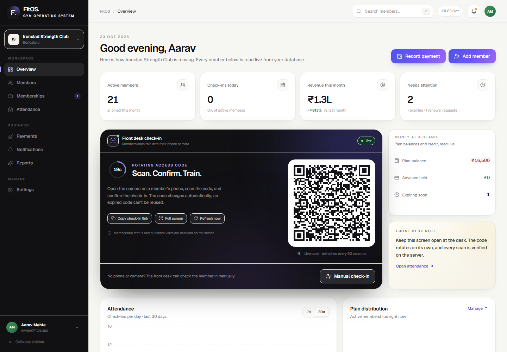
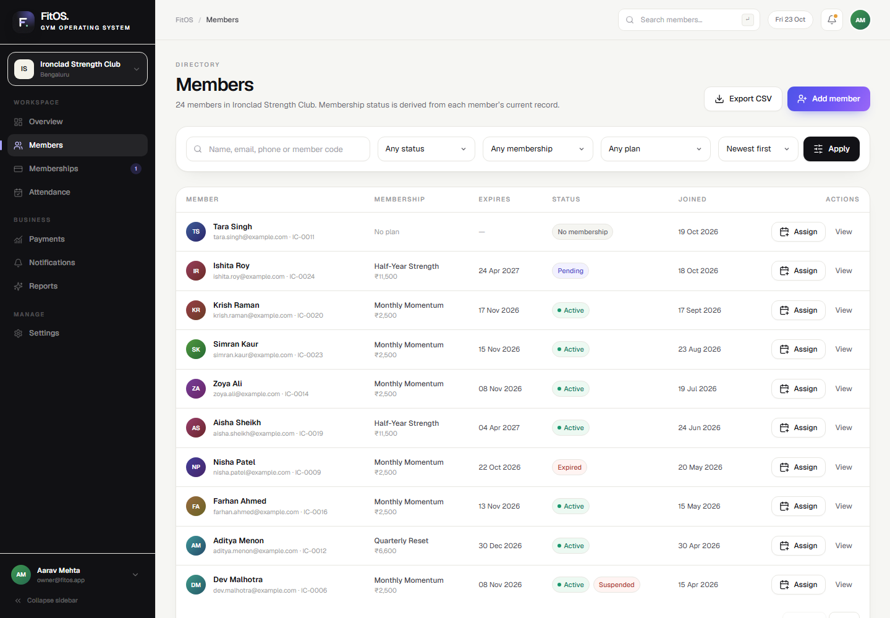
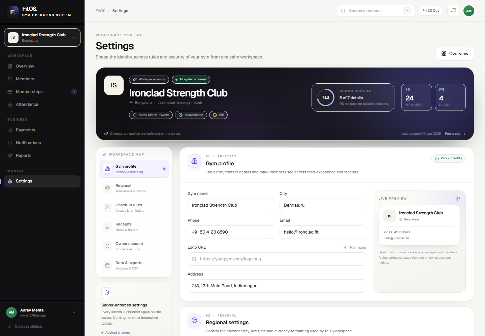
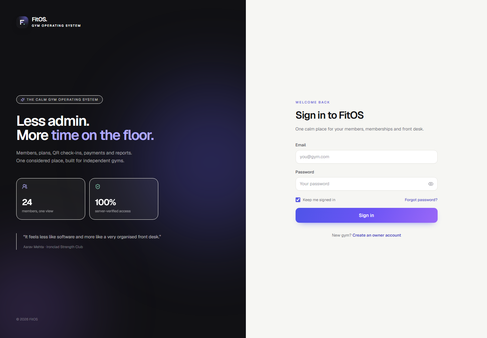
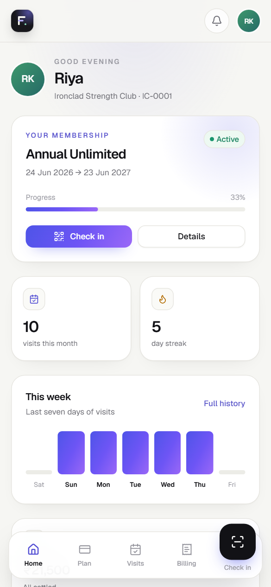

<p align="center">
  
</p>

<h1 align="center">FitOS</h1>

<p align="center"><strong>The calm operating system for independent gyms.</strong></p>

<p align="center">
  <a href="https://github.com/DragAditya/fitos-app/actions/workflows/ci.yml"></a>
  <a href="https://nextjs.org/"></a>
  <a href="https://react.dev/"></a>
  <a href="https://www.typescriptlang.org/"></a>
  <a href="https://www.postgresql.org/"></a>
  <a href="LICENSE"></a>
</p>

<p align="center">
  <a href="https://fitos-app-wheat.vercel.app">Live app</a> ·
  <a href="#features">Features</a> ·
  <a href="#quick-start">Quick start</a> ·
  <a href="#architecture">Architecture</a> ·
  <a href="#deployment">Deployment</a>
</p>

FitOS is a full-stack gym management SaaS for independent gyms. Owners run members, plans, memberships, QR attendance, payments and receipts, notifications, reports, and workspace settings from one place. Members get a mobile-first portal for their plan, visits, billing, notifications, and personal check-in QR.

It is a real, persistence-backed application: relational data, transactional writes, server-side authorization, and no mock data at runtime. Settings are not decorative — every toggle and policy is enforced on the server.

> **Live deployment:** [fitos-app-wheat.vercel.app](https://fitos-app-wheat.vercel.app)<br />
> Production uses managed PostgreSQL with demo seeding and demo login disabled. The screenshots below use the bundled demo workspace.

---

## Screenshots

| Owner dashboard | Members |
| --- | --- |
|  |  |

| Settings | Sign in |
| --- | --- |
|  |  |

<p align="center">
  
  <br />
  <em>Member portal — mobile-first, with a personal check-in QR.</em>
</p>

---

## Features

- **One front-desk workspace.** Dashboard, members, member detail/edit, plans, attendance, payments, notifications, reports, and settings — with a collapsible desktop sidebar, top bar, search, and profile menu.
- **Members and memberships.** Search, filter, sort, paginate, invite by link, export CSV, assign or cancel plans, handle renewal requests, and keep a full membership ledger.
- **QR attendance that is enforced.** A live rotating gym code, HMAC-signed member tokens with a revocable nonce, server-side membership checks, duplicate check-in prevention, and a manual fallback.
- **Honest payments and receipts.** Money is stored in integer paise, receipts are printable, refunds remove a payment from collected revenue, and exports label manual entries.
- **Notifications and reminders.** Publish announcements to all or selected members, track read state, and trigger expiry/payment reminder batches. There is intentionally no background scheduler.
- **Database-backed reporting.** KPIs, revenue trends, plan mix, attendance streaks, outstanding balances, and plan performance are computed from persisted rows.
- **Advanced workspace settings.** Gym branding and logo, member ID prefix, self check-in pause, reminder window, receipt footer, owner profile/password, active-session revocation, and CSV exports — all persisted and enforced server-side.
- **A real member portal.** Home, plan, visits, billing and receipts, notifications, profile, and a personal QR with refresh/revoke controls.
- **Server-side security by default.** Every page and action re-checks the session; every query is scoped by gym; members can only read their own records.
- **Calm, fast UI.** Warm off-white surfaces, Geist typography, native page transitions with a blur/fade handoff, reduced-motion support, keyboard-usable dialogs, and visible focus states.

---

## What is inside

### Owner workspace

| Screen | What it does |
| --- | --- |
| `/dashboard` | Live KPIs, attendance trend, revenue chart, plan mix, expiring memberships, renewal requests, and the front-desk check-in code |
| `/members` | Search, status/plan filters, sorting, pagination, invite links, and CSV export |
| `/members/[id]` | Profile, membership, payments, attendance, notifications, QR controls, renewal request, and audit trail |
| `/members/[id]/edit` | Edit profile, status, emergency contact, and notes |
| `/plans` | Create/edit plans, plan performance, membership ledger, assign/cancel memberships, and renewal requests |
| `/attendance` | Daily log, QR scanner, manual check-in, date filters, and CSV export |
| `/payments` | Record payments, filter, issue receipts, refund, and export |
| `/notifications` | Compose announcements, select audiences, and trigger reminder batches |
| `/reports` | Date-range revenue and attendance analytics, plan revenue, payment methods, outstanding members, and CSV exports |
| `/settings` | Gym profile, regional settings, member codes, self check-in, reminders, receipts, owner account, and data exports |

### Member portal

| Screen | What it does |
| --- | --- |
| `/me` | Greeting, membership card and progress, visit stats, weekly chart, billing summary, notifications, and recent visits |
| `/me/profile` | Personal details, password change, account metadata, and sign out |
| `/me/membership` | Current plan, benefits, progress, renewal request, and plan history |
| `/me/attendance` | Month calendar, streak, total visits, weekly bars, and recent check-ins |
| `/me/payments` | Paid/outstanding summary and printable receipts |
| `/me/notifications` | Personal inbox with mark-one/mark-all read |
| `/me/qr` | Personal signed QR, refresh/revoke controls, and check-in guidance |

### Public and shared routes

- `/` — marketing landing page
- `/login`, `/register`, `/forgot-password`, `/reset-password`
- `/join/[token]` — invited member account creation
- `/checkin` — member check-in screen opened by the gym's live QR
- `/receipts/[id]` — printable receipt, scoped to the owning gym owner or the named member
- `/api/health` — liveness plus database counts
- `/api/attendance/live-qr` — authenticated rotating gym check-in code
- `/api/export/[type]` — owner-only CSV exports: `members`, `payments`, `attendance`, `memberships`, `plans`

---

## Tech stack

| Layer | Choice |
| --- | --- |
| Framework | Next.js 16.4 (App Router, Server Components, Server Actions) |
| UI | React 19.3, TypeScript, Tailwind CSS 4, Radix primitives, Lucide icons |
| Forms | React Hook Form + Zod |
| Charts | Recharts |
| Database | PGlite locally; managed PostgreSQL via `pg` when `DATABASE_URL` is set |
| Auth | Custom email/password with scrypt hashing and DB-backed HttpOnly sessions |
| QR | `qrcode` for rendering, HMAC-SHA256 for signing, `@zxing/browser` for scanning |
| Motion | React/Next native View Transitions with a CSS fallback |
| Tests | Vitest (unit) and Playwright (end-to-end) |
| Deployment | Vercel + Neon, or a single self-hosted Node process with PGlite |

No Supabase and no third-party auth. PGlite is the zero-setup local database; setting `DATABASE_URL` switches the same schema and queries to managed PostgreSQL.

---

## Quick start

### Requirements

- **Node.js 20.9+** (22 LTS recommended)
- **npm**
- A modern browser for the UI; Chromium for the Playwright suite

### Local setup

```bash
npm install
cp .env.example .env.local
```

On PowerShell:

```powershell
Copy-Item .env.example .env.local
```

Generate a QR secret and put it in `.env.local`:

```bash
node -e "console.log(require('crypto').randomBytes(32).toString('base64url'))"
```

Then start the app:

```bash
npm run dev
```

Open [http://localhost:3000](http://localhost:3000). The first request initializes PGlite at `.data/fitos` and, when `FITOS_SEED_DEMO=true`, seeds the demo gym. Seeding includes password hashing and demo history, so the first load can take a few seconds.

<details>
<summary><strong>Local demo accounts</strong> (only created by the bundled seed)</summary>

| Role | Email | Password |
| --- | --- | --- |
| Owner | `owner@fitos.app` | `FitOS2026!` |
| Member | `member@fitos.app` | `FitOS2026!` |

The demo gym is **Ironclad Strength Club** (Bengaluru) with 24 members, four plans, memberships, payments, attendance, notifications, renewal requests, and audit history. Demo mode adds one-click login buttons to `/login`; set `FITOS_DEMO_MODE=false` to hide them.

These are public demo credentials. Never enable demo seeding on a database that holds real member data. Production should use `FITOS_SEED_DEMO=false` and `FITOS_DEMO_MODE=false`.

</details>

### Production build

```bash
npm run build
npm start
```

### Using managed PostgreSQL

Set `DATABASE_URL` to a managed PostgreSQL connection string and restart. The app auto-creates the schema on the first request. On serverless platforms, use the **pooled** connection string. See [Deploying FitOS](docs/DEPLOYMENT.md).

---

## Environment variables

| Variable | Required | Default | Purpose |
| --- | --- | --- | --- |
| `DATABASE_URL` | Vercel / managed | unset | Managed PostgreSQL connection string. When set, PGlite is not used. Use the **pooled** URL on serverless platforms. |
| `DATABASE_POOL_MAX` | No | `3` | Max PostgreSQL connections per app instance. Keep small with a pooled endpoint. |
| `DATABASE_SSL` | No | auto | Force TLS on/off. Auto-enables for non-local database hosts. |
| `DATABASE_SSL_REJECT_UNAUTHORIZED` | No | `false` | Set `true` to verify the database server certificate. |
| `FITOS_AUTO_MIGRATE` | No | `true` | Auto-create the schema (and seed when empty) on the first connection. Set `false` after applying `db/migrations/0001_init.sql` yourself. |
| `FITOS_DATA_DIR` | Local only | `.data/fitos` | Directory where PGlite stores its database. Ignored when `DATABASE_URL` is set. |
| `QR_TOKEN_SECRET` | Production | dev fallback | 32+ random characters used to sign QR tokens. Production refuses to boot without it unless `FITOS_ALLOW_DEV_SECRETS=true`. |
| `NEXT_PUBLIC_APP_URL` | Recommended | `http://localhost:3000` | Absolute URL used in invite links when request headers are unavailable. |
| `FITOS_SEED_DEMO` | No | `true` | Seeds the demo gym when the database has no profiles. Set `false` in production. |
| `FITOS_DEMO_MODE` | No | `true` | Shows/hides one-click demo login on `/login`. Set `false` in production. |
| `FITOS_SHOW_RESET_LINK` | No | `false` in production | Shows the password reset link in the UI even in production. Only useful until an email provider is connected. |
| `FITOS_ALLOW_DEV_SECRETS` | No | `false` | Production escape hatch for a missing QR secret. Never use in a real deployment. |

Copy `.env.example` to `.env.local` for local development. `.env.local` is ignored by git.

---

## Scripts

| Command | What it does |
| --- | --- |
| `npm run dev` | Start the development server. |
| `npm run build` | Production build. |
| `npm start` | Serve the production build. |
| `npm run lint` | ESLint. |
| `npm run typecheck` | TypeScript, no emit. |
| `npm test` | Vitest unit suite — **85 tests**. |
| `npm run test:watch` | Vitest in watch mode. |
| `npm run test:e2e` | Resets `.data/e2e` and runs the **8-test** Playwright smoke suite against a production build on port 3100. |
| `npm run db:reset` | Delete `.data` so the next request re-creates and re-seeds the local PGlite database. It does **not** touch a managed database. |

> The Playwright config clears `DATABASE_URL` and runs against the isolated PGlite seed at `.data/e2e`, so the suite never touches a managed database.

---

## Architecture

```text
src/
  app/
    (auth)/            login, register, password reset, invite acceptance
    (owner)/           owner shell + 10 screens + route template
    (member)/          member shell + 7 screens + route template
    checkin/           member check-in experience
    receipts/[id]/     shared printable receipt
    api/               health, live QR, CSV exports
  components/
    ui/                button, input, dialog, table, badge, avatar, charts…
    owner/             owner client islands (forms, dialogs, scanner, tables)
    member/            member shell and mobile forms
    forms/             action runner, copy button, print button
    page-transition.tsx  native View Transition wrapper
  lib/                 dates, money, membership rules, metrics, QR, CSV, Zod
  server/
    auth/              scrypt hashing, sessions, guards
    actions/           server actions ("use server") for every mutation
    services/          database access and business rules
    db/                PGlite/pg client, schema, seed
    audit.ts           audit log writer
    rate-limit.ts      in-memory limiter for auth and scan endpoints
```

### Navigation and motion

Owner, member, and auth routes use route-group `template.tsx` files that wrap the page content in React's `<ViewTransition>`. The page content gets a subtle blur/fade/lift handoff while the shell, sidebar, header, and member navigation stay anchored. Browsers without View Transition support get a CSS entrance fallback; `prefers-reduced-motion` disables the motion. The implementation lives in `src/components/page-transition.tsx` and `src/app/globals.css`.

### Authorization model

- Sessions are random 32-byte tokens stored hashed (SHA-256) in `sessions`; the raw token lives in the `fitos_session` HttpOnly, SameSite=Lax cookie for 30 days.
- `requireOwner()` and `requireMember()` redirect unauthenticated or wrong-role requests before rendering. API routes call `getAuth()` and return `401`/`403`.
- Server actions never trust an ID from the client: they load the record with the authenticated `gym_id` (and `member_id` for member actions) before mutating.
- Ownership is provisioned only by the trusted register action. Invite acceptance and demo login can only produce member accounts.
- Members cannot read another member's payments, attendance, notifications, QR, or receipt; unknown IDs return `404`.
- Settings and policy changes are written to the audit log.

### Data model

`profiles`, `gyms`, `gym_members`, `membership_plans`, `memberships`, `attendance`, `payments`, `notifications`, `notification_recipients`, `member_qr_tokens`, `sessions`, `password_reset_tokens`, `renewal_requests`, `audit_logs`.

- All money is an integer in **paise** (`250000` = ₹2,500.00).
- Calendar dates are `date` columns; timestamps are `timestamptz`.
- One active membership per member is enforced by a partial unique index.
- One attendance row per member per day is enforced by a unique constraint.
- The migration mirror lives at `db/migrations/0001_init.sql`.

### Revenue and attendance rules

- Revenue = sum of payments with status `paid` only. Pending, failed, and refunded are excluded.
- Refunds are excluded rather than subtracted: refunding a payment removes it from collected revenue.
- Outstanding = pending + failed amounts.
- A check-in requires an active member account and a live membership (pending, expired, cancelled, suspended, and inactive are rejected with a specific reason).
- Streaks count consecutive visit days ending today, or ending yesterday so a member does not lose a streak before the gym opens.

### QR token design

```text
fitos:v1:<opaque_record_id>:<nonce>:<HMAC-SHA256 signature>
```

- The payload contains no name, email, phone, membership, or gym identifier.
- The signature covers the record id, nonce, member id, and gym id with `QR_TOKEN_SECRET`.
- Refresh increments the nonce; revoke marks the record inactive. Both invalidate every previously printed or screenshotted code immediately.
- The front-desk scanner uses a rotating gym code; self check-in can be paused from Settings, and scans are validated server-side against the database, member status, and membership.
- A second scan on the same day returns a duplicate result instead of creating a row.

### Settings enforcement

`/settings` is a real control surface, not a mock preferences screen:

- Gym name, contact details, logo URL, city, timezone, currency, and receipt footer are persisted.
- The member code prefix is applied to newly created member codes.
- Disabling self check-in pauses member-initiated scans immediately; owner/manual check-in remains available.
- The reminder window controls expiry batches.
- Owner profile and password changes require the current password and are audited.
- Other active sessions can be revoked from the owner account panel.
- CSV exports are generated server-side and scoped to the authenticated gym.

### Notifications

Notifications and per-recipient read state are persisted in the database. The owner can publish announcements to all or selected members and trigger expiry/payment reminder batches from the UI. There is **no background scheduler**; reminders run only when an owner presses the button.

### Exports

CSV exports are owner-only, streamed with `text/csv; charset=utf-8`, prefixed with a UTF-8 BOM for Excel, and carry `manual_entry_not_gateway_verified` in the payment method/verification columns. No export contains another gym's data.

---

## Testing

```bash
npm run typecheck
npm run lint
npm test
npm run test:e2e
npm run build
```

- **Unit tests — 85 tests** cover calendar math and timezones, membership eligibility and progress, attendance streaks, QR token format/tamper cases, revenue rules, CSV escaping, formatting, and settings behavior.
- **Playwright smoke tests - 8 tests** start from a fresh seed at `.data/e2e` on port 3100 and run against a production build, so dev-server recompiles cannot interfere. They cover every owner workspace screen, the advanced settings controls, settings persistence, paused self check-in, manual check-in success/duplicate/no-membership rejection, the member portal, the QR screen, a printable receipt, and notification reads.
- The suite runs serially (`workers: 1`) because the tests share one isolated database.

Playwright downloads its browser on first run:

```bash
npx playwright install chromium
```

### CI

The GitHub Actions workflow runs typecheck, lint, unit tests, and a production build on every push and pull request. A second job runs the Playwright suite with Chromium against a production build.

---

## Deployment

### Vercel + Neon (recommended)

Vercel functions have no persistent disk, so production uses managed PostgreSQL. Neon is a good fit: a free tier, standard `pg` driver, no Supabase.

1. Create a Neon project and copy its **pooled** connection string.
2. Import this repository into Vercel.
3. Add these environment variables:

   ```dotenv
   DATABASE_URL=postgresql://...-pooler...neon.tech/neondb?sslmode=require
   QR_TOKEN_SECRET=<64-char random value>
   NEXT_PUBLIC_APP_URL=https://your-app.vercel.app
   FITOS_SEED_DEMO=false
   FITOS_DEMO_MODE=false
   FITOS_SHOW_RESET_LINK=false
   FITOS_ALLOW_DEV_SECRETS=false
   DATABASE_POOL_MAX=3
   ```

4. Deploy. The first request creates the schema.
5. Check `https://your-app.vercel.app/api/health`; it should report `"database": "postgres"`.
6. For real data, start empty and create the owner account at `/register`.

> Never leave `FITOS_SEED_DEMO=true` on a database that holds real member data.

Full steps, region guidance, backups, upgrades, and the self-hosted option are in [docs/DEPLOYMENT.md](docs/DEPLOYMENT.md).

### Self-hosted PGlite (single instance)

```bash
cp .env.example .env.production   # set a real QR_TOKEN_SECRET and app URL
# FITOS_SEED_DEMO=false, FITOS_DEMO_MODE=false
npm ci
npm run build
npm start
```

Run **one application instance** with a persistent volume mounted at `FITOS_DATA_DIR`. PGlite cannot be shared by multiple instances.

### Security checklist

- [ ] `QR_TOKEN_SECRET` is 32+ random characters and unique to the deployment.
- [ ] `FITOS_SEED_DEMO=false` and `FITOS_DEMO_MODE=false` for real data.
- [ ] `FITOS_SHOW_RESET_LINK=false` until email delivery exists.
- [ ] HTTPS is enforced.
- [ ] The database uses TLS and a pooled endpoint on serverless.
- [ ] Backups and restore have been tested.
- [ ] Logs and `/api/health` are monitored.

---

## Known limitations

- **PGlite is single-node.** It is intended for local development or a single self-hosted instance. Vercel deployments use managed PostgreSQL.
- **Rate limiting is in-memory.** It is per process and resets on restart; serverless instances do not share counters.
- **No production email provider.** Password reset and invite links are created but copied manually; keep `FITOS_SHOW_RESET_LINK=false` in production.
- **Payments are recorded manually.** There is no gateway integration or webhook verification; exports label every payment as a manual entry.
- **No background scheduler.** Expiry and payment reminders are owner-triggered batches.
- **No file uploads.** Member avatars render as deterministic initials; `logo_url` accepts an external HTTPS image.
- **No staff role, plan self-purchase, 2FA, or audit-log UI.** The audit table is written to and surfaced on member detail where relevant.
- **No gym deletion or ownership transfer.**
- **Timezone and currency are gym-wide**, defaulting to `Asia/Kolkata` and `INR`.
- **Native page transitions degrade gracefully.** Unsupported browsers get the CSS fallback, and reduced-motion preferences disable them.

These are scope boundaries, not placeholders: every shipped control performs a real, authorized action.

---

## Contributing

Issues and pull requests are welcome. Read [CONTRIBUTING.md](CONTRIBUTING.md) before opening a PR. For security vulnerabilities, follow [SECURITY.md](SECURITY.md) instead of opening a public issue.

## License

**All rights reserved.** This repository is source-available for viewing and evaluation; no permission is granted to use, copy, modify, or redistribute the code without prior written permission. See [LICENSE](LICENSE).
